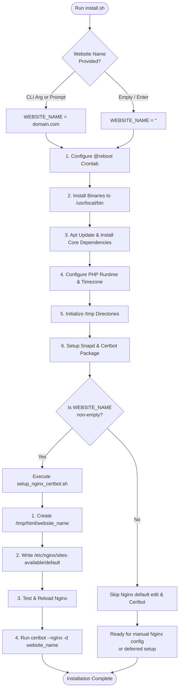

# Remote Server Installation Process & Website Variable Guide

This document outlines the architecture, step-by-step workflow, and variable logic for the server provisioning scripts in this repository.

---

## 1. High-Level Architecture & Workflow

The installation suite automates system packages, directory structures, PHP/SQLite runtime, timezone alignment, and web hosting configurations on a Debian/Ubuntu remote server.



---

## 2. The `WEBSITE_NAME` Variable

The `WEBSITE_NAME` variable controls whether automated web serving (Nginx) and SSL provisioning (Certbot) are performed during the installation, or deferred for manual/custom setup.

### How `WEBSITE_NAME` is Supplied
The variable can be specified in two ways:
1. **Command-Line Argument**:
   ```bash
   ./install.sh example.com
   ```
2. **Interactive Prompt**:
   If no argument is passed, [install.sh](file:///addr.bar/tricurse/server/install.sh) displays an explanation and prompts:
   ```text
   Enter website name (or press Enter to skip):
   ```
   *Note: Input is automatically sanitized to remove protocol prefixes (`http://`, `https://`), trailing slashes, and whitespace.*

---

## 3. Case-by-Case Breakdown: How `WEBSITE_NAME` Affects Procedures

| Procedure / Script | When `WEBSITE_NAME` is Specified (`example.com`) | When `WEBSITE_NAME` is NOT Specified (`""`) |
| :--- | :--- | :--- |
| **Directory Initialization** ([install_temporary_directories.sh](file:///addr.bar/tricurse/server/install_temporary_directories.sh)) | Creates `/tmp/html`, `/tmp/log/nginx`, and the site directory `/tmp/html/example.com` with `755` permissions and `www-data` ownership. Unpacks `html.tar` if present. | Creates base `/tmp/html` and `/tmp/log/nginx`. Unpacks `html.tar` if present. Does not create a named site folder. |
| **Nginx Default Configuration** ([setup_nginx_certbot.sh](file:///addr.bar/tricurse/server/setup_nginx_certbot.sh)) | **Executed**: Backs up original config to `default_0`. Generates `/etc/nginx/sites-available/default` (and local [default](file:///addr.bar/tricurse/server/default)) configured to serve from `/tmp/html/example.com`, prioritizes `index.php`, protects SQLite/hidden files, tests syntax (`nginx -t`), and reloads Nginx. | **Skipped**: `/etc/nginx/sites-available/default` is left untouched. You can configure virtual hosts or default settings manually. |
| **Certbot SSL Registration** ([setup_nginx_certbot.sh](file:///addr.bar/tricurse/server/setup_nginx_certbot.sh)) | **Executed**: Runs `certbot --nginx -d example.com` to request and bind an SSL certificate automatically. | **Skipped**: Certbot is not executed, preventing empty-domain failures or unwanted interactive prompts. |
| **System Packages** ([install.sh](file:///addr.bar/tricurse/server/install.sh)) | **Executed**: Installs Nginx, Snapd, Certbot binary, curl, unzip, SQLite3, PHP-FPM, PHP-CLI, PHP-SQLite3, and helper scripts in `/usr/local/bin`. (No fail2ban, no MySQL/MariaDB). | **Executed**: Identical base setup is performed. The server environment is fully installed. |
| **PHP Runtime & Timezone** ([install.sh](file:///addr.bar/tricurse/server/install.sh)) | **Executed**: Detects PHP version, enables PHP-FPM socket, configures `date.timezone = America/New_York` (EDT) across all `php.ini` files, aligns system timezone, and starts PHP-FPM. | **Executed**: Identical. PHP-FPM runtime and timezone are ready regardless of site name. |

---

## 4. Deep Dive into Connected Procedures

The procedures for **updating Nginx** and **running Certbot** are tightly coupled because:
1. Certbot requires a valid Nginx `server_name` and document `root` to complete ACME HTTP-01 or Nginx-plugin challenges.
2. The Nginx document root must match the directory `/tmp/html/${WEBSITE_NAME}` where site assets reside.

Both steps are encapsulated in [setup_nginx_certbot.sh](file:///addr.bar/tricurse/server/setup_nginx_certbot.sh).

### Procedure Details in [setup_nginx_certbot.sh](file:///addr.bar/tricurse/server/setup_nginx_certbot.sh):
1. **Document Root Creation**:
   Creates `/tmp/html/${WEBSITE_NAME}` and applies `chmod 755` with `chown www-data:www-data` so the web server user can read and serve files. If the directory is empty, a lightweight placeholder `index.html` is created.
2. **PHP-FPM Socket Detection**:
   Automatically detects the active PHP version (e.g. `8.2` or `8.5`) to write the correct `fastcgi_pass unix:/run/php/php<version>-fpm.sock;` directive.
3. **Nginx Configuration Generation**:
   Generates `/etc/nginx/sites-available/default` with:
   - `server_name ${WEBSITE_NAME};`
   - `access_log /tmp/log/nginx/${WEBSITE_NAME}.log;`
   - `root /tmp/html/${WEBSITE_NAME};`
   - `index index.php index.html;` (PHP entry prioritized)
   - FastCGI PHP configuration matching the installed PHP version.
   - Built-in location protection for SQLite database files (`.sqlite`, `.db`, `.sql`) and dotfiles.
   Enables the site via symlink in `/etc/nginx/sites-enabled/` and tests with `nginx -t`.
4. **Certbot Execution**:
   Calls `certbot --nginx -d "${WEBSITE_NAME}"`.

---

## 5. Running the Connected Setup at a Later Time

If a user runs [install.sh](file:///addr.bar/tricurse/server/install.sh) without specifying a website name, they can run the connected Nginx and Certbot configuration whenever they are ready:

```bash
sudo ./setup_nginx_certbot.sh mynewsite.com
```

Or run interactively:
```bash
sudo ./setup_nginx_certbot.sh
```

---

## 6. Architecture & Subdomain Setup Notes

- **Zero MySQL / MariaDB**:
  MariaDB/MySQL server daemons (`install_mysql_php_fpm.sh` and `install_mariadb_php_fpm.sh`) are excluded. The server stack uses direct file access via **SQLite** (`php-sqlite3`, `sqlite3`), eliminating database server overhead and daemon maintenance.
- **Fail2ban Removed**:
  Automated fail2ban installation and SSH jail rules have been removed.
- **Proper PHP Timezone Syntax**:
  PHP timezone is automatically configured to `America/New_York` (representing EDT / Eastern Daylight Time). IANA timezone identifiers do not use spaces; `America/New_York` avoids `PHP Startup: Invalid date.timezone value 'America/New York'` errors.
- **Subdomain Routing & Hotletter Package Deployment**:
  1. Setting up a domain by running `./install.sh <domain>` configures the web root at `/tmp/html/<domain>`, sets up Nginx with PHP-FPM, and acquires SSL.
  2. Running the `https://hotletter.band` package installer (`/addr.bar/tricurse/contact/install.sh`) next detects the existing Nginx site and deploys directly into the configured document root, connecting to persistent SQLite message storage.
